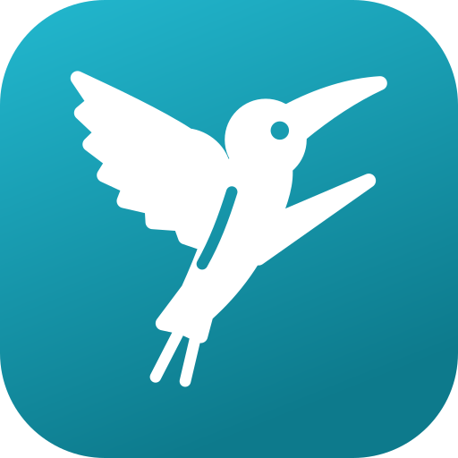
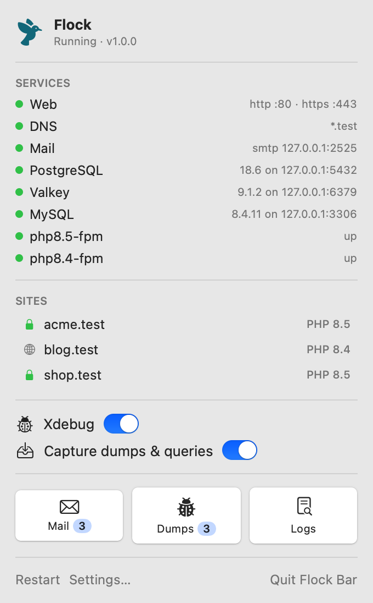
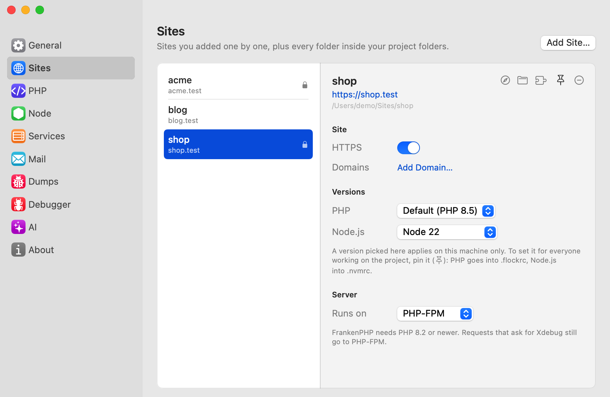
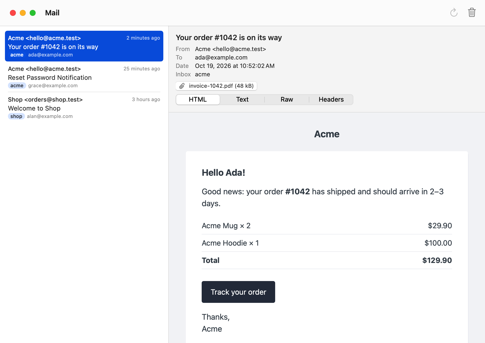
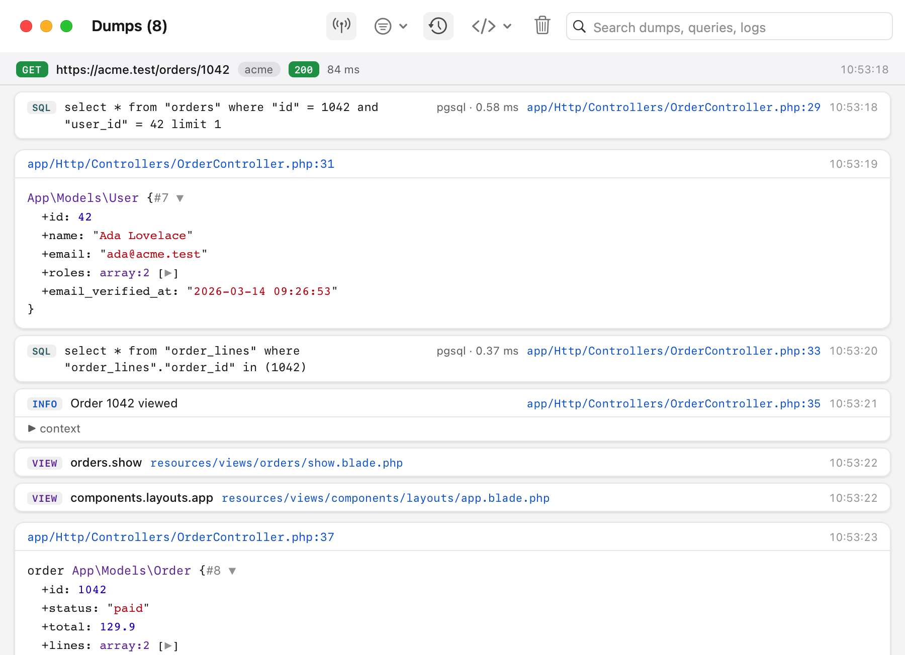
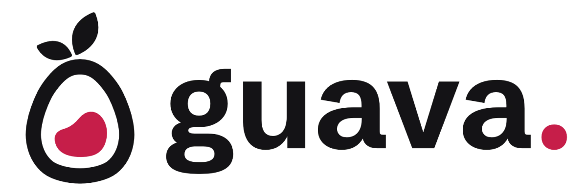

<p align="center">
  
</p>

<h1 align="center">Flock</h1>

<p align="center">
  <strong>Local Laravel development, natively.</strong><br>
  .test domains with real HTTPS, a PHP version per project, databases in one click and every email caught.<br>
  For macOS, Windows and Linux. No Docker, no virtual machine.
</p>

<p align="center">
  <a href="https://flockphp.com">Website</a> ·
  <a href="https://flockphp.com/docs/quick-start">Documentation</a> ·
  <a href="https://flockphp.com/download">Download</a> ·
  <a href="https://flockphp.com/compare">Compare</a>
</p>

<p align="center">
  <a href="https://github.com/flock-php/flock/releases"></a>
  
  <a href="LICENSE"></a>
</p>

**Flock is a free, open-source local development environment for PHP and Laravel on macOS, Windows and Linux.** It runs PHP, Node.js, your databases and the web server as native processes, so there's no Docker and no virtual machine. You drive it from a menu bar app on macOS, a tray app on Windows, a window with a top bar icon on Linux, or the `flock` command line. There's no paid tier and no account.

https://github.com/user-attachments/assets/ac36d8eb-2522-4ad7-851b-052e74e759e7

## Features

- **.test domains with real HTTPS.** Park a folder, or link one project, and every app gets its own `.test` domain, subdomains included. HTTPS works without browser warnings. See [Domains](https://flockphp.com/docs/domains) and [HTTPS](https://flockphp.com/docs/https).
- **A PHP version per project.** PHP 8.1 to 8.5 run side by side, and each project picks its own. Node.js too, from `.nvmrc`. See [PHP](https://flockphp.com/docs/php) and [Node.js](https://flockphp.com/docs/node).
- **Databases in one click.** PostgreSQL, MySQL, MariaDB, MongoDB, Valkey, Meilisearch and RustFS (plus Typesense on macOS and Linux, and Redis on macOS) run as native processes that start with your computer. See [Services](https://flockphp.com/docs/services).
- **Every email, caught.** Mail your apps send lands in a local inbox, one per app, and never reaches real people. See [Mail](https://flockphp.com/docs/mail).
- **`dump()` without the mess.** `dump()` and `dd()` output, queries, logs and views show up in a timeline grouped by request, with links to your editor. No code changes needed. See [Dumps](https://flockphp.com/docs/dumps).
- **Step debugging, only when you need it.** Xdebug slows every request, so it stays off until you turn it on. See [Xdebug](https://flockphp.com/docs/xdebug).
- **Git worktrees, served on their own.** Each worktree gets its own domain and is set up automatically, database included. See [Worktrees](https://flockphp.com/docs/worktrees).
- **Share a site in one command.** Send a public link to a local site through a Cloudflare tunnel. See [Sharing](https://flockphp.com/docs/sharing).
- **Made for AI agents.** A built-in MCP server lets coding agents like Claude Code and Cursor read your sites, mail, dumps and errors. See [AI](https://flockphp.com/docs/ai).

Flock works with any PHP project, not only Laravel.

## Showcase

<table>
  <tr>
    <td width="32%" valign="top">
      <picture>
        <source media="(prefers-color-scheme: dark)" srcset=".github/art/panel-running-dark.png">
        
      </picture>
    </td>
    <td valign="top">
      <picture>
        <source media="(prefers-color-scheme: dark)" srcset=".github/art/settings-sites-dark.png">
        
      </picture>
    </td>
  </tr>
  <tr>
    <td colspan="2">
      <picture>
        <source media="(prefers-color-scheme: dark)" srcset=".github/art/mail-window-dark.png">
        
      </picture>
    </td>
  </tr>
  <tr>
    <td colspan="2">
      <picture>
        <source media="(prefers-color-scheme: dark)" srcset=".github/art/dumps-window-dark.png">
        
      </picture>
    </td>
  </tr>
</table>

## Installation

Download the installer for your system from [flockphp.com/download](https://flockphp.com/download) or the [releases](https://github.com/flock-php/flock/releases), open Flock and click **Set up Flock**.

| | macOS | Windows | Linux |
| --- | --- | --- | --- |
| System | macOS 15 Sequoia or newer, Apple silicon | Windows 10 (2004) or 11, x64 | Ubuntu 24.04 or newer or current Fedora, x64 or arm64; Arch Linux, x64 |
| Installer | `Flock-<version>-macOS.dmg` | `Flock-Setup-<version>-x64.exe` | `.deb` or `.rpm` package, or `flockphp-bin` from the AUR |
| App | Menu bar | Notification area (tray) | Window and top bar icon |

On Linux, Flock needs systemd-resolved as the system's DNS resolver (the default on Ubuntu and Fedora). The package names the command `flk`, because `/usr/bin/flock` is the system's file-locking tool; after setup, `flock` works too.

Flock needs ports 80 and 443. If you use another local environment, stop it first. See [Installation](https://flockphp.com/docs/installation) for what setup changes on your system.

## Quick start

```sh
cd ~/Code
composer create-project laravel/laravel acme
flock park                  # every folder in ~/Code is served at http://<folder>.test
flock secure acme           # HTTPS for acme.test

cd acme
flock pin php 8.5           # this project's PHP version, saved in .flockrc
flock services install postgres
flock services create-db postgres acme
```

Then open [https://acme.test](https://acme.test). The [Quick start](https://flockphp.com/docs/quick-start) goes through it step by step, including the `.env` settings for the database and mail. Every command is listed in the [CLI reference](https://flockphp.com/docs/cli).

## How Flock compares

Flock covers the same ground as Laravel Herd, Laragon and XAMPP, but it's free on every system, runs natively on macOS, Windows and Linux, and includes mail, dumps and Xdebug without a paid tier. The comparison pages go through it feature by feature:

- [Flock vs Laravel Herd](https://flockphp.com/vs/laravel-herd)
- [Flock vs Laragon](https://flockphp.com/vs/laragon)
- [Flock vs XAMPP](https://flockphp.com/vs/xampp)
- [Flock vs ServBay](https://flockphp.com/vs/servbay), [FlyEnv](https://flockphp.com/vs/flyenv), [Local](https://flockphp.com/vs/localwp) and [AppServ](https://flockphp.com/vs/appserv)

## FAQ

**Is Flock free?**
Yes. Flock is free and open source under the AGPL-3.0. There's no paid tier and no account.

**Does Flock use Docker?**
No. PHP, Node.js, the databases and the web server run as native processes on your machine, with no containers and no virtual machine.

**Does Flock only work with Laravel?**
No. It's built with Laravel in mind, but any PHP project works: WordPress, Symfony, Statamic or plain PHP.

**Can I switch from Herd, Valet or Laragon?**
Yes. Stop the other environment so ports 80 and 443 are free, then install Flock and park your projects folder. See [Installation](https://flockphp.com/docs/installation).

## Building from source

Flock is a Go daemon and CLI (`cmd/flock`) with a native app on each system: SwiftUI on macOS (`macos/`), WinUI 3 on Windows (`windows/`) and GTK 4 with libadwaita, in Rust, on Linux (`linux/`).

```sh
make build      # the CLI, into bin/flock
make test       # Go tests
make lint
make app        # the macOS app, into build/macos/Flock.app
```

The Windows app is described in [windows/README.md](windows/README.md). On Linux, `linux/build-packages.sh` builds the CLI and the app into `.deb` and `.rpm` packages (it needs Rust and the GTK 4, libadwaita and WebKitGTK 6 development packages).

## Contributing

Bug reports and ideas are welcome in [Issues](https://github.com/flock-php/flock/issues), questions in [Discussions](https://github.com/flock-php/flock/discussions). Pull requests start with an approved issue and go to the `main` branch; see [CONTRIBUTING.md](CONTRIBUTING.md) for how it works.

## Developed by Guava

<a href="https://guava.cz/en">
  <picture>
    <source media="(prefers-color-scheme: dark)" srcset=".github/art/guava-dark.png">
    
  </picture>
</a>

Flock is built and maintained by **[Guava](https://guava.cz/en)**, a small software studio from the Czech Republic. We build custom web and mobile apps, information systems and AI tools for our clients, mostly with Laravel, Livewire and Filament.

We also maintain open-source packages for the Laravel and Filament community, such as [Calendar](https://github.com/GuavaCZ/calendar), [Knowledge Base](https://github.com/GuavaCZ/filament-knowledge-base) and [Icon Picker](https://github.com/GuavaCZ/filament-icon-picker). See them all on [GitHub](https://github.com/GuavaCZ).

Need something built? [Get in touch](https://guava.cz/en).

## Credits

- [Guava](https://guava.cz/en)
- [Lukas Frey](https://github.com/lukas-frey)
- [Stepan Mocjak](https://github.com/Uolsen)
- [Marc Beinder](https://github.com/onairmarc)
- [All contributors](https://github.com/flock-php/flock/graphs/contributors)

## License

Flock is free software, licensed under the [GNU Affero General Public License v3.0](LICENSE) (AGPL-3.0-only). Copyright © 2026 Guava s.r.o. See [NOTICE](NOTICE) for the additional permission for the Windows App SDK.

Flock is not affiliated with or endorsed by Laravel.
