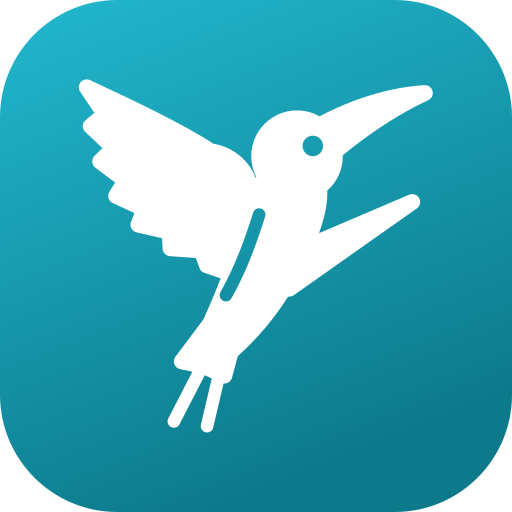
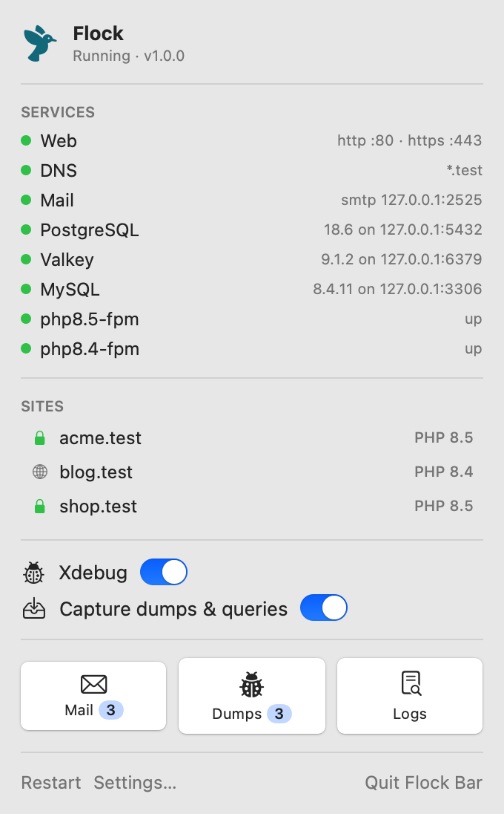
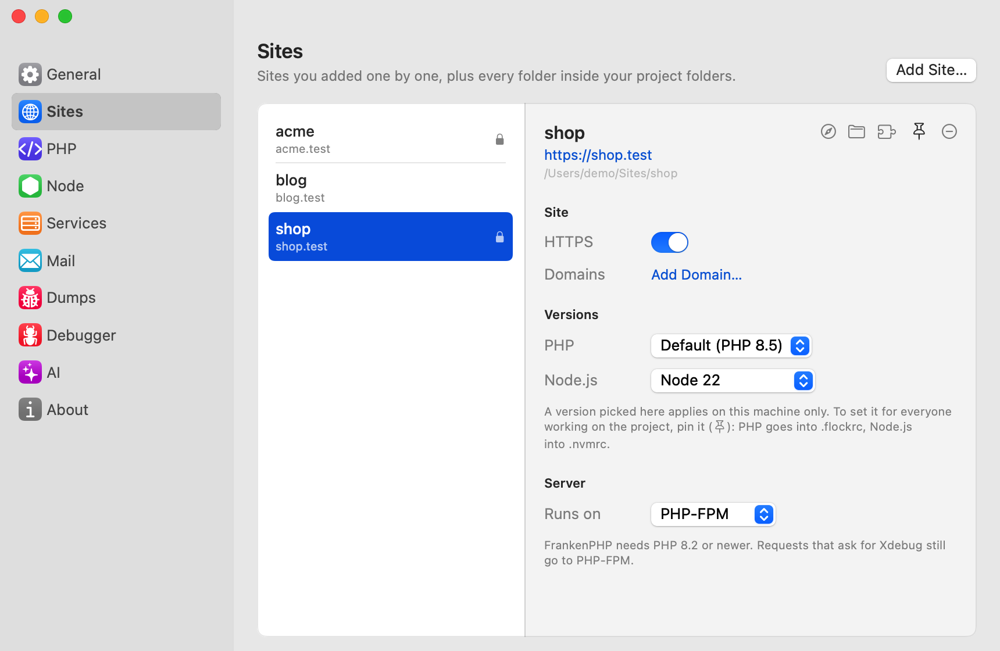
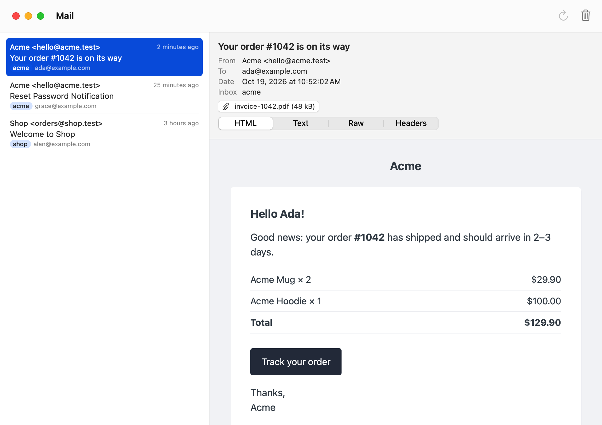
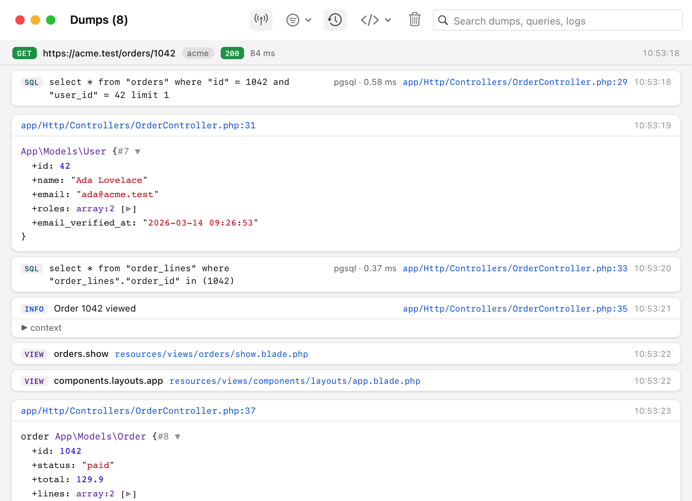
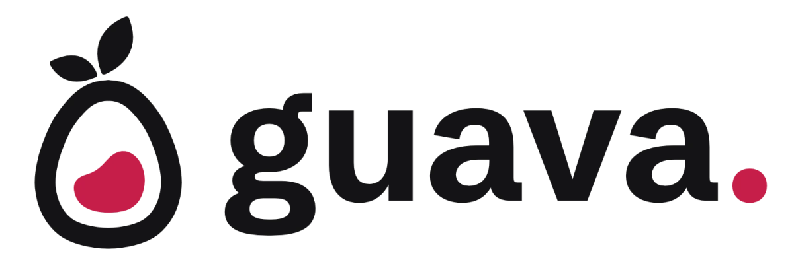

<p align="center">
  
</p>

<h1 align="center">Flock</h1>

<p align="center">
  <strong>Local Laravel development, natively.</strong><br>
  .test domains with real HTTPS, a PHP version per project, databases in one click and every email caught.<br>
  For macOS and Windows. No Docker, no virtual machine.
</p>

<p align="center">
  <a href="https://flockphp.com">Website</a> ·
  <a href="https://flockphp.com/docs/quick-start">Documentation</a> ·
  <a href="https://flockphp.com/download">Download</a>
</p>

<p align="center">
  <a href="https://github.com/flock-php/flock/releases"></a>
  
  <a href="LICENSE"></a>
</p>

https://github.com/user-attachments/assets/ac36d8eb-2522-4ad7-851b-052e74e759e7

Flock runs PHP, Node.js, your databases and the web server as native processes, from a menu bar app on macOS and a tray app on Windows, or from the `flock` command line. It's free and open source, with no paid tier and no account.

## Documentation

The full documentation is at [flockphp.com/docs](https://flockphp.com/docs/quick-start). Start with the [Quick start](https://flockphp.com/docs/quick-start).

## Features

- **.test domains with real HTTPS.** Park a folder, or link one project, and every app gets its own `.test` domain, subdomains included. HTTPS works without browser warnings.
- **A PHP version per project.** PHP 8.1 to 8.5 run side by side, and each project picks its own. Node.js too.
- **Databases in one click.** PostgreSQL, MySQL, MariaDB, MongoDB, Valkey, Meilisearch and RustFS (plus Redis and Typesense on macOS) run as native processes that start with your computer.
- **Every email, caught.** Mail your apps send lands in a local inbox, one per app, and never reaches real people.
- **`dump()` without the mess.** `dump()` and `dd()` output, queries, logs and views show up in a timeline grouped by request, with links to your editor. No code changes needed.
- **Step debugging, only when you need it.** Xdebug slows every request, so it stays off until you turn it on.
- **Made for AI agents.** A built-in MCP server lets coding agents read your sites, mail, dumps and errors.

Flock works with any PHP project, not only Laravel.

## Showcase

<table>
  <tr>
    <td width="32%" valign="top">
      <picture>
        <source media="(prefers-color-scheme: dark)" srcset=".github/art/panel-running-dark.png">
        
      </picture>
    </td>
    <td valign="top">
      <picture>
        <source media="(prefers-color-scheme: dark)" srcset=".github/art/settings-sites-dark.png">
        
      </picture>
    </td>
  </tr>
  <tr>
    <td colspan="2">
      <picture>
        <source media="(prefers-color-scheme: dark)" srcset=".github/art/mail-window-dark.png">
        
      </picture>
    </td>
  </tr>
  <tr>
    <td colspan="2">
      <picture>
        <source media="(prefers-color-scheme: dark)" srcset=".github/art/dumps-window-dark.png">
        
      </picture>
    </td>
  </tr>
</table>

## Installation

Download the installer for your system from [flockphp.com/download](https://flockphp.com/download) or the [releases](https://github.com/flock-php/flock/releases), open Flock and click **Set up Flock**.

| | macOS | Windows |
| --- | --- | --- |
| System | macOS 15 Sequoia or newer, Apple silicon | Windows 10 (2004) or 11, x64 |
| Installer | `Flock-<version>-macOS.dmg` | `Flock-Setup-<version>-x64.exe` |
| App | Menu bar | Notification area (tray) |

Linux is on the roadmap.

Flock needs ports 80 and 443. If you use another local environment, stop it first. See [Installation](https://flockphp.com/docs/installation) for what setup changes on your system.

## Quick start

```sh
cd ~/Code
composer create-project laravel/laravel acme
flock park                  # every folder in ~/Code is served at http://<folder>.test
flock secure acme           # HTTPS for acme.test

cd acme
flock pin php 8.5           # this project's PHP version, saved in .flockrc
flock services install postgres
flock services create-db postgres acme
```

Then open [https://acme.test](https://acme.test). The [Quick start](https://flockphp.com/docs/quick-start) goes through it step by step, including the `.env` settings for the database and mail.

## Building from source

Flock is a Go daemon and CLI (`cmd/flock`) with a native app on each system: SwiftUI on macOS (`macos/`) and WinUI 3 on Windows (`windows/`).

```sh
make build      # the CLI, into bin/flock
make test       # Go tests
make lint
make app        # the macOS app, into build/macos/Flock.app
```

The Windows app is described in [windows/README.md](windows/README.md).

## Contributing

Bug reports and ideas are welcome in [Issues](https://github.com/flock-php/flock/issues), questions in [Discussions](https://github.com/flock-php/flock/discussions). Pull requests start with an approved issue and go to the `develop` branch; see [CONTRIBUTING.md](CONTRIBUTING.md) for how it works.

## Developed by Guava

<a href="https://guava.cz/en">
  <picture>
    <source media="(prefers-color-scheme: dark)" srcset=".github/art/guava-dark.png">
    
  </picture>
</a>

Flock is built and maintained by **[Guava](https://guava.cz/en)**, a small software studio from the Czech Republic. We build custom web and mobile apps, information systems and AI tools for our clients, mostly with Laravel, Livewire and Filament.

We also maintain open-source packages for the Laravel and Filament community, such as [Calendar](https://github.com/GuavaCZ/calendar), [Knowledge Base](https://github.com/GuavaCZ/filament-knowledge-base) and [Icon Picker](https://github.com/GuavaCZ/filament-icon-picker). See them all on [GitHub](https://github.com/GuavaCZ).

Need something built? [Get in touch](https://guava.cz/en).

## Credits

- [Guava](https://guava.cz/en)
- [Lukas Frey](https://github.com/lukas-frey)
- [Stepan Mocjak](https://github.com/Uolsen)
- [All contributors](https://github.com/flock-php/flock/graphs/contributors)

## License

Flock is free software, licensed under the [GNU Affero General Public License v3.0](LICENSE) (AGPL-3.0-only). Copyright © 2026 Guava s.r.o. See [NOTICE](NOTICE) for the additional permission for the Windows App SDK.

Flock is not affiliated with or endorsed by Laravel.
